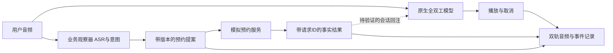

# 原生全双工预约 Agent 方案

日期：2026-10-20，America/Chicago。本文保留最初方向设计；未微调PersonaPlex Demo已实现，当前[中文使用](https://github.com/HenryVarro666/local-speaker-lab/blob/main/experiments/scheduling/README.zh-CN.md)和[缓存延迟证据](https://github.com/HenryVarro666/local-speaker-lab/blob/main/experiments/scheduling/native-injection/LATENCY_RESULTS.md)是执行入口。默认整句工具文字受控、全部原生声音，干净音色/角色前缀缓存把十次回注→网关首声中位3.338降至1.552秒（53.52%）；两轮插话同编号改期及额外时间共12段关键波形通过。编号口播B K number one对应卡片BK-0001，上下文和起句使用同一别名。自由续说额外样例有失败，未选主展示。真人验收、冻结任务与训练仍未完成，不能把设计目标当实测成绩。

后续预填充候选中位0.898秒，但额外日期波形失败，共11/12关键检查，未替换1.552秒主版本；见[新实验](https://github.com/HenryVarro666/local-speaker-lab/blob/main/experiments/scheduling/native-injection/PREFILL_RESULTS.md)。

建议用一个能处理插话更正的预约 Agent 做展示入口，复用 DuplexLab 的数据审阅、版本和训练实验。核心问题是：**用户在系统说话或工具等待期间改口时，Agent 能否保留最新意图、正确完成预约，并保持自然的听说时序？**

## 1 一个可看懂的演示

先做英语、耳机、虚构通用服务预约，界面同时显示双轨声音、日期时间槽位和工具事件。固定业务日期与 America/Chicago 时区，将相对日期转换为明确日期。

1. 用户要求预约周四下午三点，Agent 查询空位并开始复述。
2. Agent 说话时用户插入：“Actually, Friday at four thirty.” 系统让出话轮，划掉旧提案，显示更正后的日期时间。
3. 用户只说“uh-huh”时，系统按上下文识别附和，不将它自动视作预约授权，也不对每次人声都清空回答。
4. 用户在工具等待时再次更正。旧查询即使稍后返回，也不能覆盖新提案；确认只对当前版本有效。
5. 用户确认后，模拟预约服务写入并返回回执。界面展示实际写入内容，语音准确复述结果。
6. 最后播放一个失败案例，进入回听纠正和数据导出，说明下一轮训练要修什么。

首版包含查询空位、创建、改期、取消四种模拟操作。先打通创建与改期，再扩取消；不用真实客户、真实日历或电话接入。真人麦克风录制与合成脚本分别标识。

## 2 为什么这个方向有价值

预约将交互行为变成可核验的业务结果：日期、时间、服务类型、确认对象以及最终数据库状态都有明确答案。展示可以连接“听起来顺畅”和“实际做对”，数据工作也有具体错误来源。

已有 Full-Duplex-Bench 包含停顿、插话、附和和环境讲话评测，v3 已覆盖真人不流畅语音与多步工具使用。因此“全双工加工具”本身不能当作新研究贡献。这里先做可复现的应用实验，进一步聚焦更正与异步工具结果之间的版本一致性，以及对应数据筛选是否改善下游表现；论文新颖性需另外系统核查。[作者仓库](https://github.com/DanielLin94144/Full-Duplex-Bench) · [v3 论文](https://arxiv.org/abs/2604.04847)

## 3 模型选择与第一个技术关口

| 位置 | 建议 | 已核实能力与待验证内容 |
| --- | --- | --- |
| 第一版交互模型 | PersonaPlex 7B | 官方支持英语连续听说、角色文字提示和声音条件；先验证插话、更正与持续会话，不预设中文能力 |
| 级联基线 | 当前 voice_ai 的架构，另配英语 ASR/TTS | 现部署是中文，必须形成新的英语配置和测量，不能直接拿旧四轮中文结果比较 |
| 后续增加的一个原生模型 | MiniCPM-o 4.5 | 官方支持中英双语和全双工；只先跑同一英语集合，中文另立结果表 |

PersonaPlex 的官方模型卡明确英语输入输出，仓库提供服务、音频流回放和 CPU offload。**本轮在所查官方使用入口中未找到现成的结构化工具调用与动态工具结果回注示例**；这不等于模型不能扩展，但不能把它当作现成功能。[模型卡](https://huggingface.co/nvidia/personaplex-7b-v1) · [官方使用入口](https://github.com/NVIDIA/personaplex)

MiniCPM-o 4.5 官方 PyTorch Web Demo 要求至少 28 GB 显存；另有量化 C++ 全双工路径，官方列出低资源 NVIDIA GPU 至少 12 GB 的条件。两条实现需分别验证，不能把量化推理条件当作训练预算，也不能认定当前有其他服务的 5080 已有足够余量。[官方模型说明](https://github.com/OpenBMB/MiniCPM-V/blob/main/docs/minicpm_o4dot5_en.md)

**先做一个技术验证，再决定大规模接入：** 同一连续语音会话中，模拟工具返回“刚才的时间已无空位”，系统能否接收新事实、取消待播旧内容并准确说明结果？同时检查是否必须重置会话，以及重置会丢失什么。

若只能把静态空位写进开场提示词，当前成果只能叫预约对话演示。若结果播报需外部 TTS 或重建会话，应明确标为混合 Agent，并记录切换耗时、声音变化与上下文恢复。无法让口头结果与工具事实一致时，不进入完整预约 Agent 的验收；可以保留原生模型的交互评测，或重新选择支持所需上下文接口的后端。

## 4 语音模型与预约状态如何连接

原始用户音频直接进入全双工模型，持续生成输出语音；业务观察器可并行做 ASR、日期时间抽取和意图识别。观察器输出不冒充全双工模型自身的转写或工具能力。

业务层至少维护 `proposal_version`、`request_id`、`operation_id`、`confirmation_version`、`slots` 和 `status`。日期更正产生新版本；已在等待的旧查询可以保留日志，但过期结果不能更新当前提案。重复提交相同 operation_id 不得创建第二份预约。

状态顺序为：收集信息 → 查询 → 提案 → 明确确认 → 提交 → 工具回执。更正或撤回使当前确认失效。工具提交成功后再听到更正，应创建明确的改期/取消操作；不能声称已经撤销一项完成的操作。提交与更正的先后以服务器提交顺序和音频事件共同记录，不承诺逆转已经发生的写入。

自然附和与授权分开处理，模糊肯定应澄清。第三人的背景说话、播放回声与用户插话分开标注。只静音播放器不代表模型已经忘掉旧回答，必须另查生成状态与残留内容。

若采用外部确认播报，提交和结果阶段由该模块独占输出，记录原生生成的取消/恢复。未经验证的模型口头“已预约”不得作为成功回执。无法控制这种错误播报时，系统仍处在技术验证阶段。

## 5 数据怎样补起来

先用 **20 个开发任务**找接口和行为问题，再冻结 **60 个独立测试任务家族**，暂按以下六类各 10 个设计。数字是建议规模，不是已有数据。

| 分组 | 要发现的问题 |
| --- | --- |
| 正常预约与改期 | 日期、时间、服务及最终写入正确 |
| 说话中更正 | 系统让出话轮并采用新意图，不丢插话开头 |
| 停顿与附和 | “嗯”“uh-huh”、犹豫和句中停顿不触发不当提交 |
| 工具等待时改口 | 过期查询、延迟响应及重复请求不污染当前状态 |
| 撤回、拒绝与无空位 | 不再执行旧动作、不编造成功回执 |
| 背景讲话与声学干扰 | 区分目标插话、旁人讲话和回声；外放另验收 |

每个任务保存：源音频及哈希、真人/合成、许可或录制授权、说话人/session、任务家族、相对日期基准、用户和 Agent 分轨、转写与时间标注、插话起止、期望槽位更新、期望动作、实际工具请求/响应及最终数据库快照。对话轨道共享时间基准；不先混为一条单声道。

双工训练导出与现有 ASR 导出分开：保留原始双轨及时序，按目标模型生成专用格式；ASR 可以另导出 16 kHz 单声道用户片段，不能覆盖双轨原件。合成变体及同一原对话的切片按家族共同划分。测试任务及其失败不得回流本轮训练；挖掘错误使用开发集或另建训练采集集。

真实麦克风测试至少包含现场闭环对话；固定录音回放用于可重复压力测试，不能代替用户依据系统回复继续说话的交互评测。单人录制只能说明该说话人上的结果；有多个独立说话人时再做说话人隔离。首轮可由本人完成协议验证，外部展示需明确人数与输入来源。

复用 DuplexLab 的来源清单、音频检查、去重、回听纠正和冻结导出，新增预约状态与双轨事件。不要改动历史 ASCEND 200/725 条实验或把它们重新指定为预约盲测。

## 6 训练证据分两层补

### 优先完成能影响预约结果的 ASR 数据实验

先沿用已有 Qwen3-ASR-0.6B 训练方向，重点收集数字日期、更正否定、停顿和插话开头的用户语音。它训练的是业务观察器的识别模块；展示时明确说“ASR 微调”，不能改称“训练了 PersonaPlex”。

在独立训练池中，用同一基座比较：未微调、随机选样微调、按开发错误类型筛选后微调。先用几十条跑训练、保存和重载 smoke，再决定正式样本量。两训练组匹配音频时长、步数与计算预算；筛选不能看到测试答案。报告日期时间错误、改口后槽位正确率、最终任务成功率及普通语音退化，连接识别变化与业务结果；依靠不同系统组件时保留对应归因。

### 原生语音模型后训练作为下一层

Kyutai 官方 `moshi-finetune` 提供 LoRA、双声道对话加时间转写的数据路径和适配器重载。其参考单 H100 配置峰值分配显存约 **39.6 GB**；缩短序列或减 batch 需重新实测，不能据此承诺 16 GB 卡可训。[官方训练入口](https://github.com/kyutai-labs/moshi-finetune)

**资源更新：用户于 2026-10-20 告知有两张 H100。** 卡型、每卡显存、互联、空闲与环境尚未实机核验；这不是 apex 5080 的配置变更。若每卡 80 GB 且可独占，官方 Moshi 参考 LoRA 的显存需求有空间，原生后训练可以作为可行性实验，不必再以只有 16 GB 为前提推迟。

官方参考为 rank128、100秒序列、每卡batch16、2000步，单H100约12000 token/s。依其9个预测流、12.5Hz公式，单卡每步约180000 token，2000步约8.3小时。若两卡保持**全局batch16**，以合计12000–24000 token/s的近单卡至理想双卡吞吐情形作预算估算：

| 训练预算 | 训练循环时间估算 |
| --- | --- |
| 20–50步链路验证 | 约3–13分钟 |
| 100–300步小试验 | 约15–75分钟 |
| 1000–2000步较完整试验 | 约2–8.5小时 |

这些时间从训练步开始到结束，不含环境、下载、数据制作、初始加载、额外评测和保存/重载；不是H100实测或训练效果保证。双卡每卡仍用batch16会使全局batch变32，同步数不代表相同训练量，也不会自动将固定步数耗时减半。互联和数据管线可能令实际耗时超出此区间。正式预算先用预热后的连续训练步测速，再加评测与checkpoint开销。[配置](https://github.com/kyutai-labs/moshi-finetune/blob/main/example/moshi_7B.yaml) · [训练token计数](https://github.com/kyutai-labs/moshi-finetune/blob/main/train.py)

2000步按全局batch16和100秒计算约888.9小时音频曝光；小数据集不能直接照抄该步数，应按数据时长、重复次数和开发集表现决定停止。数据与训练器已就绪时，首轮checkpoint可按数小时安排；首次适配与多轮评测的工程预算可暂留1–3天，数据收集另计，不能保证该时间内达到目标质量。

PersonaPlex 基于 Moshi，不代表该训练器可以不改动地处理它的角色/声音前缀。先核对 checkpoint、配置、前缀与损失掩码，完成一次保存和重载验证；未通过时不宣传 PersonaPlex LoRA。可将官方 Moshi 作为独立后训练试验，但必须明确其基座不同。

有训练资源后，再比较同一双工基座的未训练、随机双轨样本、筛选双轨样本三组。优先教会等待、让出话轮、附和与改口恢复；保留原始停顿和重叠。错误对话用于发现和审阅，不能把错误 Agent 回复直接当作正例训练。训练集的目标 Agent 行为与音频需另行获得或修正并回听。

只有 loss 下降、能够重载属于训练链路证据；冻结测试改善才属于效果证据。ASR 后训练和原生语音后训练分别报告，前者不能替代后者的经历。

### 不微调的第一版

PersonaPlex已提供英语全双工权重、角色文字提示与声音条件，可以先做预约角色的零样本对话和插话测试。[官方模型卡](https://huggingface.co/nvidia/personaplex-7b-v1)

实际预约仍由业务状态、模拟工具和会话结果回注实现；这些工程接口即使做LoRA也需要完成。建议先完成未微调版本与冻结基线，按开发失败决定是否训练。训练重点可落在停顿、附和、更正与任务遵循，库存、日历和预约事实由运行时工具提供。

## 7 对照怎样做才有解释力

第一轮是“英语级联基线 vs PersonaPlex Agent”，后续再加一个 MiniCPM-o 4.5。先固定业务工具、日期规则、确认策略、任务与设备；冻结每组的模型/量化、提示词、生成参数和播放器设置。尽量使用相同硬件条件，做不到时将资源差异与延迟一起报告。

拆成两种实验：

- **语音交互比较**：测原生输出对插话、更正、停顿与附和的响应，记录模型自己的回答和修正。相同固定录音可用于此处，工具状态变化单独注入和核验。
- **完整系统比较**：实测工具闭环、槽位和最终写入。若两组共用同一 ASR 观察器和控制器，成功率可能主要由共享组件决定，不能据此把改进归功于原生模型的工具能力。

主要结果先报告“完成全部约束的任务数/全部预定任务数”、最终槽位正确率、错误或重复写入次数，以及口头成功与真实回执矛盾的次数。超时、无声、异常和未完成保留在分母；不能只统计成功轮。

| 指标 | 计时或判定定义 |
| --- | --- |
| 说完到有效回复首声 | 用户最后一个有声采样 → 浏览器排定首个含有效答复的有声采样；另记纯附和首声 |
| 插话让出延迟 | 目标用户插话首个有声采样 → 本次旧输出最后一个有声采样；允许的短附和另标 |
| 更正采用等待 | 用户更正信息最后一个有声采样 → 当前提案变为正确版本；同时报告最终是否做对 |
| 预约完成等待 | 当前版本明确确认结束 → 模拟工具成功回执；另报回执到准确语音播报 |
| 错误让出/抢话 | 在附和或未完成停顿中不当终止/接管的次数，按机会数给分母 |

端到端以浏览器单调时钟和音频采样位置计时，服务器内部阶段使用服务器单调时钟，通过事件 ID 对应；不直接相减两台机器未同步的时间戳。浏览器排定播放不含扬声器硬件延迟。录音用于实时压力测试时按采样时间分块送入，不提前暴露后文；离线回放的音频时轴延迟与真实墙钟处理时间分别给出。CPU offload 或快于实时的离线处理不证明实时可用。

新会话、热运行、严格冷启动，合成回放、真人耳机与真人外放分别报告。小样本先给逐次数据与中位数，不声称稳定 p95。官方延迟、旧 DSH 中文四轮结果和新系统成绩不拼表当同条件对照。

## 8 实施顺序与目录

| 阶段 | 交付与验收 |
| --- | --- |
| A 可行性验证 | 独立环境运行英语连续听说；验证取消、结果回注和资源条件。失败则记录并调整后端或明确混合方案 |
| B 可演示闭环 | 先实现创建/改期的模拟工具、版本状态和回执，保存一个真人耳机现场更正案例及完整日志 |
| C 可复现评测 | 20 个开发任务后冻结 60 个测试家族，补英语级联基线；分开语音交互与完整工具结果 |
| D 数据与首轮训练 | 开发错误进入审阅，完成独立训练池与 ASR 随机/筛选对照，保存可重载 checkpoint 和失败 |
| E 深化 | 增加 MiniCPM-o 4.5 英语对照；有资源再开展双工后训练，中文与外放分别扩展 |

不沿用此前“48 小时 ASR Demo、5–7 天首轮 ASR 训练”的估时作为此方案承诺。模型运行和工具回注未验证前，不给原生双工 Agent 的确定交付日期。前两项技术验证最先决定投入价值。

继续建议以既有 `local-speaker-lab` 承载实验数据、评测、回放和 ASR 训练，未来新增预约实验模块；模型运行器使用独立进程和环境。当前工作区保留方案与进度，不创建新的仓库，不将业务模块塞进 DSH 插件。具体模块安排在 A 阶段确认后再写任务计划。

这是一条独立实验，不要求先完成 DSH 的全部 M0–M5。复用或修改 DSH 运行候选时，仍需完成对应的 M0 兼容回归、M1 计时与 M2 真人验证；旧部署和其他服务保持独立。当前 apex 资源状态没有在本轮刷新，不安排与已有服务同卡共驻，也不停止其他任务。

## 9 展示与证据边界

第一段录像展示真人插话改期、当前提案和真实模拟回执；第二段展示失败音频、审阅纠正、训练数据版本与对照结果。预约操作成功以工具状态验证，交互自然性用音频和人工回听补充，不能由文字转写单独证明。

岗位证据分开：数据岗位对应来源、清洗、去重、标注、导出和训练增益；Speech LLMs 对应音频处理、流式时序、ASR 训练与完整评测，原生双工后训练另需实际完成。短期作品不能替代相关论文或大规模生产经历。

本轮完成的是方案和官方资料核对。没有访问 apex、下载权重、安装依赖、调用合成接口、录制、推理、训练或改动运行代码；没有启动子代理、提交或推送。环境继续引用 PROJECT_STATUS 中最近的 2026-10-20 核验快照。
