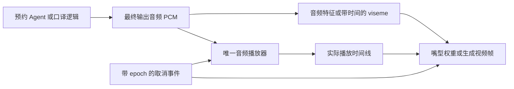
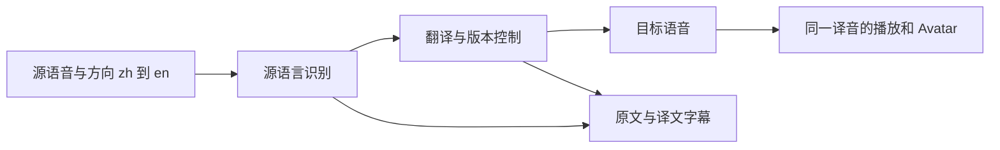

# Avatar 口型生成 技术路线 实验指南

初版日期：2026-10-20，America/Chicago。本文定义技术路线及阶段协议；最新进展见下方实施记录。DSH/apex 状态继续以 [PROJECT_STATUS](../PROJECT_STATUS.md) 最近核验为准。

**2026-10-20 实施更新：** 用户授权后，[独立 speech-avatar 仓库](https://github.com/HenryVarro666/speech-avatar/blob/main/PROJECT_STATUS.md)已创建，E0 完成 36 条合成语音和双虚构人物的结构冻结，E1 在另一台双 H100 NVL 主机完成全部 12 个离线组合，完整解码/源音轨检查通过。首张保存帧/完整任务中位 3.003/7.165 秒、RTF 1.999，计时不含共享加载。[质量审查](https://github.com/HenryVarro666/speech-avatar/blob/main/experiments/2026-10-20-e1-musetalk/QUALITY_REVIEW.md)完成，结论 NEEDS WORK：12/12 本机浏览器播完、1,032 帧嘴部全查，SyncNet 估计画面领先声音 80–120 ms，另有齿列、收尾和静态自然度问题。人工连续音画评分缺失，≥10/12 门槛未通过；先按 E1-Q1–Q4 验证同步、收尾、细节与动态参考。详见 [E0](https://github.com/HenryVarro666/speech-avatar/blob/main/experiments/2026-10-20-e0/RESULTS.md) / [E1](https://github.com/HenryVarro666/speech-avatar/blob/main/experiments/2026-10-20-e1-musetalk/RESULTS.md)。质量审查只用本机 CPU；未连接 apex，未提交或推送；优化与 E2–E5 未开始。

**建议新建一个小而独立的 `speech-avatar` 仓库，承载音频驱动的 Avatar、同步、取消与展示回放。** 当前 `voice_ai` 保留已测语音基线和历史实验；预约 Agent、ASR 数据与训练继续按既定路线推进。新仓库通过适配器消费它们的输出音频，不再内置一套 ASR、LLM、TTS 或预约业务。

技术上先完成两个有限验证：**MuseTalk 离线真实口型**回答“是否值得拍进展示视频”；**浏览器 viseme 驱动**回答“能否实时跟随且不拖慢语音”。DUIX 保留兼容对照，不作为新实时链路的默认依赖。

下文设计和验收阈值保留为协议，阶段是否完成以顶部实施记录和独立仓库结果为准。主展示方向仍是[原生全双工预约 Agent](../docs/superpowers/specs/2026-10-20-native-duplex-scheduling-proposal.md)；口译是第二个接入场景。

**完整表情扩展补充（2026-10-20）：** 针对用户的中文僵硬、人设音色错配和完整人物动态要求，新增[后端比较与接入路线](Avatar%20%E5%AE%8C%E6%95%B4%E8%A1%A8%E6%83%85%20%E9%80%89%E5%9E%8B%20%E6%89%A9%E5%B1%95%E8%B7%AF%E7%BA%BF.md)。离线真人样片优先 LongCat-Video-Avatar 1.5，OmniAvatar 为轻量/研究备选，Hunyuan 为条件性第三选择；实时仍单独验证浏览器角色。已核对默认段长截音、OmniAvatar 静音前缀、动态人脸评测与现有播放器/epoch 接点。该结论为文档和源码选型，未运行新候选、修改语音主链路或改变 E1 签收状态。

## 1 对应口型到底如何生成

### 1.1 驱动源必须是最终输出音频

对应口型不是“检测到正在说话就循环开嘴”。需要从音频中得到随时间变化的嘴部形状，或者直接生成嘴部图像。



口译时，中文源语音经过识别、翻译和英语语音生成后，**嘴型跟随英语译音**。源语音只供识别和原文展示；不能拿中文说话时序去驱动英语嘴型。原生语音模型已经输出 PCM 时，直接用该 PCM，不要为了 Avatar 再做一次 TTS。

一份音频同时供播放和口型生成。若两边分别合成，即使文字相同，停顿、长度、发音也可能不同。离线视频中的音轨要从这份音频复用；实时模式只有一个音频输出端，视频或 3D 渲染端不再重复发声。

### 1.2 三种生成方法

| 方法 | 怎样生成 | 能做到什么 | 主要代价 |
| --- | --- | --- | --- |
| 音量开合 | RMS/能量映射到下颌张开程度 | 低成本证明声音与画面连接；作为基线与降级 | 无法区分闭唇、咬唇、圆唇，不能称精确口型 |
| 音频到 viseme，再驱动角色 | 根据语音预测可见嘴型及其权重，按音频时轴混合角色的 morph targets | 浏览器实时角色；容易取消和控制资源 | 分类误差、角色嘴型覆盖、平滑与延迟需要实测 |
| 音频到真实人脸视频 | 音频特征与参考人脸共同输入模型，生成/修补嘴部，再合回帧 | 真实人物效果，适合视频展示 | GPU、人物预处理、首帧等待、帧间一致性与编码开销 |

viseme 是“看起来相近的发音嘴型”，不是每个音素都有唯一嘴型。例如闭唇类和元音类需要不同形状。只有文字而没有音频时间信息时，把字符平均分到整句长度只能作占位；自然停顿和拉长音会错位。预先对齐完整音频可提高离线时序控制，但不能把使用未来音频的结果当成因果流式结果。[Rhubarb 的带时间嘴型输出](https://github.com/DanielSWolf/rhubarb-lip-sync#output-formats)

## 2 当前代码可以复用到哪里

| 当前模块 | 可复用内容 | 新路线要改变的部分 |
| --- | --- | --- |
| [speaker.ts](https://github.com/HenryVarro666/dsh-voice-ai-girlfriend-plugin/blob/master/src/client/voice/speaker.ts) | PCM 播放、同一 AudioContext 排程、停止与 generation counter | 增加可选的音频分析分支和播放时间事件；当前没有 viseme 输出 |
| [companion.tsx](https://github.com/HenryVarro666/dsh-voice-ai-girlfriend-plugin/blob/master/src/client/voice/companion.tsx) | 浮窗、视频队列、历史不重播、打断停播 | 普通 task 视频只是静音循环；不能把现有 speaking 布尔值当成音素同步 |
| [reply-listener.tsx](https://github.com/HenryVarro666/dsh-voice-ai-girlfriend-plugin/blob/master/src/client/voice/reply-listener.tsx) | 回复去重、普通 TTS 与数字人分流 | 现有 dhMode 会替换逐句流式音频；新实时展示应订阅音频，不接管语音生成 |
| [voice_bridge.py](https://github.com/HenryVarro666/dsh-voice-ai-girlfriend/blob/main/bridge/voice_bridge.py) | `/api/dh/*` 与 DUIX 任务适配，可用于旧链路对照 | 当前接口按 text 再合成音频；新增渲染器要接受已经生成的音频，避免重复 TTS |
| [旧 DUIX 替身记录](../EVOLUTION.md) | 接口、队列、视频播放与抢占的历史排障经验 | 替身没有做口型，不能作为真实视觉基线或速度依据 |

不必重写已测的采集、断轮或播放器。第一次集成先在独立回放页面完成；未来若修改 DSH 插件，再同步两个源码副本，并完成相应的 M0 兼容回归。独立 Avatar 回放实验无需等待旧项目所有 M0–M5 完成。

## 3 候选方案与取舍

### 3.1 实时首选候选：HeadAudio 加浏览器角色

[HeadAudio 官方仓库](https://github.com/met4citizen/HeadAudio)提供 AudioWorklet 音频到 Oculus viseme 权重的实现，可接现有音频流。其默认模型来自四个英语合成音色；作者明确承认分类/VAD 精度有限，并提示约 50–100 ms 的处理延迟补偿。因此它适合作为第一轮轻量候选，**英语、中文、当前 Qwen3 音色和原生模型输出均要分别验证**，不预设跨域精度。

渲染端先用 Three.js 与自备的嘴型齐全角色，或经过适配的 VRM。VRM 标准有 `aa/ih/ou/ee/oh` 五类元音表情，但这些字段是可选的，也不等于完整的 Oculus 15 类嘴型。首版优先选有闭唇、咬唇及元音形状的 rig；只具备五元音的素材需新增自定义形状或明确降级，不能直接一一映射。[VRM 表情规范](https://github.com/vrm-c/vrm-specification/blob/master/specification/VRMC_vrm-1.0/expressions.md) · [three-vrm API](https://pixiv.github.io/three-vrm/docs/variables/three-vrm-core.VRMExpressionPresetName.html)

这个选择的工程理由是：分析和渲染在观看端浏览器完成，可以避开 apex 的推理 GPU 争用。它仍消耗本机 CPU/GPU，并可能拖慢页面，所以需要测帧时间和音频连续性；不能直接叫零成本。

### 3.2 离线真实口型首选候选：MuseTalk 1.5

[MuseTalk 官方仓库](https://github.com/TMElyralab/MuseTalk)提供音频驱动的人脸嘴部生成、人物预处理与推理入口。先用合法参考视频与缓存音频做视觉验证；仓库展示的 V100 帧率是作者条件下的吞吐，不能当成本机首帧或语音端到端延迟。

尤其要分清：[官方 realtime_inference.py](https://github.com/TMElyralab/MuseTalk/blob/0a89dec45a0192b824e3cf4daf96c239440c5ed8/scripts/realtime_inference.py) 的入口接收 `audio_path` 并先提取音频特征。**此入口不能直接证明“未来音频尚未到达时就能出对应画面”。** 第一轮按离线文件验证；若升级在线，再单独实现受限上下文、跨块特征连续性、出帧和取消，不以脚本名验收流式。

### 3.3 DUIX 的位置

[DUIX Avatar 官方说明](https://github.com/duixcom/Duix-Avatar)将该项目定位为非实时视频生成，保留 `/easy/submit` 与 `/easy/query` 文件任务接口，匹配当前 bridge 的适配思路。它适合验证旧接口真实出片，不是优先解决实时插话的方案。

`GuijiAI/duix.ai` 现已重定向到 [Duix Mobile](https://github.com/duixcom/Duix-Mobile)，这是另一个移动 SDK 产品。不要把它的实时能力或延迟数字套到当前服务器 Avatar 文件队列。

本轮发现 DUIX README 的商业门槛描述与当前 [LICENSE](https://github.com/duixcom/Duix-Avatar/blob/1328feb5871448c8fa3d0e45b3bbc87e7c1d458a/LICENSE) 文本不一致。选型时固定版本并记录实际代码/模型条款，不沿用旧笔记中笼统的“免费商用”。这也是新默认实现优先比较其他方案的维护理由。

### 3.4 暂不同时开工的方案

| 候选 | 用途 | 本轮决定 |
| --- | --- | --- |
| [Rhubarb](https://github.com/DanielSWolf/rhubarb-lip-sync) | 完整录音转带时间的嘴型 cue；英语与非英语识别入口不同 | 作为可选离线 2D/rig 对照，不作为在线流式实现 |
| [Audio2Face 3D SDK](https://github.com/NVIDIA/Audio2Face-3D-SDK/blob/main/docs/README.md) | 音频流转面部动画，有流式执行与回调接口 | 若浏览器嘴型质量不足且需要 3D，再评估 GPU 服务及 retarget；不在首轮增加它 |
| [Wav2Lip](https://github.com/Rudrabha/Wav2Lip#non-commercial-open-source-version) | 经典音频驱动视频嘴型基线 | 原版用途限制与旧依赖使其不适合作为新展示产品默认实现；可留研究比较 |

HeadAudio 与 three-vrm 的代码许可是 MIT；模型、角色素材和肖像授权分别记录。MuseTalk README 也区分代码、模型、第三方组件与测试素材；不把互联网测试素材顺带复制进新仓库。[HeadAudio LICENSE](https://github.com/met4citizen/HeadAudio/blob/d3af5f9ff86ab6b2b1913d411a4e1922ec101953/LICENSE) · [three-vrm LICENSE](https://github.com/pixiv/three-vrm/blob/68c7d6b1f73b79568f81139be62831968bff7876/LICENSE) · [MuseTalk 说明](https://github.com/TMElyralab/MuseTalk#disclaimerlicense)

## 4 为什么建议独立仓库

决定依据是依赖、交付物与使用者边界，实验数量多是一个信号。

| 放置方式 | 好处 | 问题 | 决定 |
| --- | --- | --- | --- |
| 继续写入 DSH 主仓库/插件 | 最快复用现有浮窗 | 再扩 bridge 大模块；GPU/视觉依赖污染语音安装；受 DSH host 绑定 | 只保留薄适配器和旧 DUIX 路径 |
| 在 voice_ai 根目录再加产品目录 | 文档就近 | 根不是 Git 仓库，版本归属含混；容易继续堆实验 | 当前只保存本指南与协调入口 |
| 写入 local-speaker-lab | 复用数据评测 | 视觉资产、WebGL 与视频推理不是 ASR 数据工具的核心依赖 | 只复用有版本的数据与回放清单 |
| 独立 `speech-avatar` | 可独立安装、测试、展示；能同时接 DSH、原生语音和口译 | 多维护一个版本与接口 | 推荐，但限制为一个小仓库 |

实施路径为 `/path/to/projects/speech-avatar`，与 `voice_ai` 同级；已在后续执行轮创建。新的 Git 仓库没有嵌入现有两个子仓库，也没有把 voice_ai 根改成大 monorepo。

它的产品承诺应是：**给一条音频及控制事件，输出可同步、可取消的 Avatar 画面与诊断记录。** 第一个例子可以是预约 Agent；第二个例子可以是口译员。不要同时另建“Avatar 预约”“Avatar 口译”“Avatar benchmark”三个仓库。

### 4.1 建议目录

以下是未来职责布局，不是本轮创建的文件或现成命令。第一版只需一个 Web 包，内含 protocol、player、renderer 三个普通模块；通过 E2–E4 后有真实复用需求再拆 packages，避免为一个演示先维护多个发布包。

```text
speech-avatar/
  README.md / README.zh-CN.md
  docs/decisions/          # 仓库边界、同步策略、模式定义
  packages/protocol/      # PCM、播放时间、epoch、取消事件
  packages/player/        # 独立回放用播放器；接入端可使用已有播放器
  packages/renderer/      # rig、嘴型映射、平滑与降级
  packages/browser-lipsync/ # HeadAudio 封装及替换接口
  adapters/voice-ai/      # DSH/bridge 的薄接入，不复制语音模型
  adapters/native-audio/  # 原生语音 PCM 接入，不要求先有转写
  workers/musetalk/       # 独立 Python 环境与离线任务
  examples/replay/        # 不依赖模型服务的可复现演示
  examples/interpreter/   # 后续消费译文和译音，业务层另有来源
  experiments/            # 每轮 PLAN、manifest、数值结果、失败
  assets/manifest.json    # 来源、许可、哈希；大媒体另存
```

JS 与 Python 各用独立锁文件/环境；不复制当前 bridge 的整个环境。可复用代码保留原许可和来源，优先提取最小接口，避免维护第二份 speaker.ts 副本。新实验留在新仓库，旧 samples 与测量不移动；集成 manifest 记录语音端和渲染端各自的版本/哈希。

这不会改变既有“预约实验与数据评测复用 local-speaker-lab”的决定：该仓库仍拥有业务评测与训练，新仓库只拥有视觉渲染与同步。

## 5 目标架构与同步规则

### 5.1 同一播放器，视觉是旁路

实时第一版使用当前音频播放器或独立回放播放器作为唯一输出端。PCM 同时送往分析分支；分析结果更新角色，异常时回到 idle 或 RMS 降级。不要让音频等待完整视频，也不要让可视化队列对音频产生背压。

在现有插件中的拟议接入点是 `ReplySpeaker.schedule()`：现在 source 直接连到 destination，未来可增加可选的共享 GainNode/分析分支，继续使用同一个 AudioContext。事件要包含实际排程时间；不要把 HTTP 收到块的时间当成已经播放。

原生模型使用自己的采样率，协议显式传 `sample_rate`、`channels`、编码与样本范围。当前 DSH PCM 是 16 kHz 单声道，不硬编码为所有模型的格式。推理端所需的重采样在适配器内部完成，保留原始样本时轴和映射。

### 5.2 最小事件契约

以下为待实现协议样例，不是现有 `/api/dh/*` 的响应。

```json
{
  "type": "audio.chunk",
  "schema_version": 1,
  "session_id": "demo-01",
  "utterance_id": "reply-03",
  "epoch": 4,
  "chunk_index": 2,
  "sample_rate": 16000,
  "channels": 1,
  "format": "s16le",
  "start_sample": 3200,
  "sample_count": 1600
}
```

PCM 数据另传二进制。独立回放页面可用 WebSocket 传块，浏览器内接入优先直接调用订阅接口；不为展示额外绕一次网络。`start_sample` 相对本 utterance，且表示生成音频时轴；播放器另发布 `playback.scheduled`，记录样本区间与 AudioContext 起点。

至少定义 `audio.start/chunk/end`、`playback.scheduled/stopped`、`visual.weights/frame`、`cancel`、`renderer.error`。未来文档还要固定缺块、重复块和错误字段语义；首轮就测试丢弃旧 epoch 与非法采样范围，不能等到在线阶段再补。

### 5.3 时钟和延迟

嘴型基准是实际排定播放时刻。对一个区间有：`audio_time = start_sample / sample_rate`；如果播放器因断流重排，必须使用新的分段映射，不能只用整句起点加累计长度。

用 AudioContext 时钟排音频；用浏览器单调时钟记 UI 事件。支持时通过 `getOutputTimestamp()` 映射二者，并记录浏览器支持情况。rAF 回调时间只能说明页面何时更新，不能冒充显示器发光或耳机出声；硬件同步另外用外部录制验证。[Web Audio 时钟说明](https://webaudio.github.io/web-audio-api/#dom-audiocontext-getoutputtimestamp)

HeadAudio 在播放后才分析可能落后。先测不新增延迟的旁路；若口型明显滞后，再在开发集比较额外音频缓冲 0/60/100 ms。利用已有排程余量或提前分析必须确认没有改写播放顺序；若分析读取了尚未到达的后文，结果归为离线。所有主动加的音频等待都计入用户响应，不能只展示校正后的同步分数。

### 5.4 取消和降级

取消命令递增 epoch，并依次停止旧音频、清除待播口型/帧、将嘴部回中性、丢弃迟到旧结果。模型任务不能立即退出时，旧 epoch 画面仍必须不可见；后台停止时间和前台停止时间分别记录。

渲染器故障、加载失败、后台标签页、WebGL context lost 或分析队列积压时，语音继续正常播放，视觉降级并显示状态。分析队列先以最多 500 ms 待处理音频为候选上限，超限丢弃过期视觉工作并恢复当前时间；这是资源策略，不允许丢语音样本。离线录制中禁止用丢帧掩盖实际生成不足。

对于新帧/权重何时接受，至少同时匹配 session、utterance 和 epoch。只按“最新任务 id”还不够，页面刷新、跨会话和重新连接也可能收到历史结果。

## 6 口译功能应该补在哪一层

口型生成与翻译是两个独立问题。新渲染仓库可以提供 interpreter 示例视图，但翻译质量与语言模型选择由上游口译模块负责。



首版先做按话轮的交替口译，并在 UI 明确 `zh→en`、`en→zh` 和当前说话者；不要默认自动判断所有中英混合输入。当前中文 Paraformer 配置不能直接视作已具备英语识别，英语输入和目标语音需另验。

翻译提交后才生成译音。源文被改写时，新版本产生新 utterance/epoch，取消旧译音与嘴型；已播出的译音不能被“撤销”，界面要保留已播记录并明确更正。若要同传，另定义分段提交、不可回改区域和相对源语音的 lag；不在第一轮与口型同步一起优化。

优先检查数字、日期、时间、否定、人名与语言方向。当前预约主展示可直接消费 Agent 的音频和状态，不必先实现上述整条口译流程。

## 7 下一轮实验与验收

以下规模与阈值是候选协议，正式运行前写入对应 PLAN 并冻结；不代表已经达成。先小样本关口，只有发现明确价值才进入下一项。

### E0 固定输入与资源条件

准备 12 条开发音频（英语/中文各 6）与 24 条独立测试音频（各 12），覆盖闭唇/咬唇、不同元音、日期数字、短停顿、轻声尾词、长句和中英混合。每种语言尽量有两种音色；不同音色和同一文本的变体按家族一起划分，避免测试文本泄漏。每条约 2–15 秒，记录真实来源，合成音、真人录音和原生模型输出分别命名；后者尚未可用时保持缺失。

保存音频哈希、实际转写、采样率、原始/裁剪边界、语言、音色来源和资产许可。先选两个有使用权的人物素材；不使用 upstream demo 人物证明自己的授权。

本机浏览器先做回放，不需 apex。GPU 试验前只读核对可用显存、GPU 外部负载、驱动、CUDA/PyTorch 与模型兼容性，记录而非猜测 5080 余量；不能把上游旧 CUDA 安装命令直接套到 Blackwell。独立环境没有资源窗口时暂停该分支，不停止其他服务。

**产物：** 冻结 manifest、12/24 划分、两个角色的形状/素材清单。未完成 E0 不做后续正式比较。

### E1 用真实生成验证画面价值

选开发集 6 条音频（英语 4、中文 2），对两个参考人物各跑一遍 MuseTalk，共 12 个输出。按固定次序全数保存，不只选最好看的结果；人物预处理和首轮模型加载分别记录，之后再记热运行。

记录从“完整 WAV 已可读且任务开始”到“首张可用帧”及“完整视频完成”，另报生成帧数/秒与处理时长除以音频时长的 RTF。直接运行官方文件脚本时若没有首帧埋点，填 null，不能从总耗时推算。脸部预处理、推理、贴回和编码耗时尽量分开。

原音频只封装一次，核对解码后的音轨长度、起点和内容；若经过有损编码，用相关性与对齐检查，不要求容器字节相同。先看清闭唇、牙齿伪影、人物身份漂移、眨眼与头动衔接。

**关口：** 12 次中至少 10 次得到可播放且没有严重面部破损的视频，并覆盖两种语言、两个人物；其余失败保留。本人评分仅是预筛，后续尽量请 3 人按随机顺序比较原循环与新视频的同步和自然度。若多数评价没有实用改进，停止真实人脸支线。

**展示标签：** 该视频是离线生成，不给出“用户说完到视频首声”的实时成绩。DUIX 不与 MuseTalk 同时大范围调参；若仅为复用旧接口，再用其中 2 条音频单独检查真实 DUIX，结果独立保存。

### E2 用浏览器验证实际嘴型与跨语言

在同一个 rig、同一播放器和同一音量下比较 idle、RMS 开合、HeadAudio 三种模式。开发集调整嘴型映射/平滑后冻结，在 24 条测试音频上各播一次，共 72 次回放；播放顺序随机，音频完全相同。

对每条测试音频预选至少 5 个可观察发音或停顿点，人工核对闭唇/元音类别和时间；不把强制对齐或预测器自身输出当作真值。若只有音频没有真实脸部参考，只评价发音约束与主观同步，不声称重建了真实嘴唇轨迹。每种语言分别报告嘴型错误、静音仍开嘴、自然度和失败数。

**关口：** HeadAudio 相对 RMS 在两种语言上都能看到更合理的嘴型变化，且无新增断音。若只在英语改善，先限定英语演示；若接近 RMS，保留简单基线，不立即训练一个新嘴型模型。原生语音输出未测时不能外推可用性。

### E3 同步、首声代价与断流

只用开发集比较额外缓冲 0/60/100 ms，共 36 次；据同步与等待的联合结果选一种。再在 24 条测试音频上做 Avatar 关闭/开启成对回放，共 48 次。两者使用同一份缓存 PCM 和同一到达时序，避免重新合成导致音频本身不同。

首声比较从回放器收到第一块 PCM 到浏览器排定的第一个有声输出采样；口型误差是同一发音事件的画面时间减音频输出时间，正值表示嘴型落后，保留符号。另做 30/60/120 ms 分块、一个缺口与重复块的固定压力用例，记录重排、丢弃与资源增长；合成网络抖动不能冒称真实网络表现。

这一轮隔离的是浏览器展示的附加代价，不包含 ASR、LLM 或新 TTS 推理。到 E5 接真实系统后，再从用户最后有声输入采样到首个有声输出测完整端到端，并分别记录 Avatar 开/关；不能用 E3 的缓存回放代替它。

**候选门槛：** 默认模式增加的首声等待中位数不超过 30 ms；同步绝对误差中位数不超过 80 ms、探索性 p95 不超过 150 ms；无断音、无重复声音。若只有额外 100 ms 等待才能好看，作为显式的录像/同步优先模式，不默认拖慢交互。24 对样本不足以声称稳定 p95，必要时再扩大，不为凑统计盲目加跑。

### E4 插话、旧结果与失效恢复

8 类事件各重复 3 次，共 24 次：句首取消、句中取消、长停顿时取消、下一轮立即到达、故意注入旧 epoch、切换会话/刷新、渲染失败、隐藏标签页后恢复。另跑 20 分钟回放循环检查内存和队列。

分别测 cancel 事件到音频停止、嘴型回中性、旧模型任务退出，暂不把上游 VAD 检测延迟混入渲染器取消耗时。接入真人后，再从实际插话开始测全链路；两种数字分开。

**候选门槛：** cancel 到旧嘴型/帧不可见不超过 100 ms；旧 epoch 零续播、重复音频零次；视觉故障时语音继续；队列有界且循环后内存无持续增长。失败任何一项先修生命周期，不再调更大的视觉模型。

100 ms 门槛用于前台可正常渲染的页面。后台标签页另报逻辑取消与页面恢复，恢复后的第一帧不得显示旧 epoch；不能把被节流的 rAF 当成前台延迟样本，也不要求后台持续绘制。

### E5 真实接入与可选口译

E2–E4 过关后，接预约 Agent 的英语耳机闭环，至少 10 个真人交互案例，包含说话中更正和工具等待时改口。检查 Avatar 开关是否改变原有行为、最新预约事实是否一致；状态与字幕来自业务事件，不从嘴型推断。

口译随后单独做 `zh→en`、`en→zh` 各 6 个简短真人用例，核对数字/否定/日期和译音嘴型。先测耳机，外放回声另设实验。没有英文 ASR 或目标语音时，只做固定译音回放，并标为渲染演示，不声称完整口译员已经完成。

**关口：** 可连续展示正常案例、插话案例和一个失败案例，日志可追溯；真人与合成、原生与级联、离线与实时各自标识。Avatar 不新增预约成功率或 ASR 训练收益的主张。

## 8 如何记录与比较

### 8.1 最小结果包

```text
experiments/<date>-<topic>/
  PLAN.md
  manifest.json        # 输入/模型/资产/依赖/两端版本与哈希
  trials.jsonl         # 每次尝试，包括失败
  events.jsonl         # 音频样本、播放排程、视觉、取消与异常
  ratings.csv          # 随机顺序、评价者、同步和自然度
  RESULTS.md           # 分母、条件、决定、下一步
```

音频和人物媒体默认保留在本地数据目录，通过哈希对应；只有具备分发许可的样例进入仓库。日志不含 DSH token、SSH 凭据、真实客户或真实预约。

### 8.2 指标含义

| 指标 | 起点与终点/含义 | 不能替代什么 |
| --- | --- | --- |
| 渲染处理延迟 | 音频片段可供分析 → 对应视觉结果可用 | 用户说完到首声 |
| 首声代价 | 同一 PCM/到达时序下 Avatar 开启减关闭的首有声输出时间 | 重新跑两次随机 TTS 的差值 |
| 口型 offset | 对应发音的视觉呈现时间减音频输出时间，保留正负 | 只有“嘴在动”的比例 |
| 完整视频 RTF | 处理墙钟时长/音频时长，拆人物准备与推理 | 首帧等待和因果流式能力 |
| 取消延迟 | 收到 cancel → 音频/画面停止；后台另报 | 真人插话检测的全过程 |
| 失败率 | 失败次数/全部尝试；分语言、素材、启动状态 | 删除坏脸、超时后的成功样本均值 |
| 口译质量 | 人工核对含义与关键槽位，ASR 错误、翻译错误、译音错误分开 | Avatar 画质或口型准确率 |

音画自动同步分数如需加入，先固定评估器版本并用有意错开时间的正负对照检查其灵敏度。真实人脸和卡通 rig 不直接混用同一评分阈值；自动分数不能替代人工同步与发音检查。

## 9 实现与优化顺序

| 顺序 | 第一批具体工作 | 何时停止扩展 |
| --- | --- | --- |
| 1 | E0 固定数据；记录新仓库边界和资产条件 | 找不到可用素材/资源时先用自备 rig，不为换头像重做语音 |
| 2 | E1 离线真实口型小样本；E2 浏览器独立回放 | 视觉收益不足时不继续追真人效果；实时方案无收益则保留 RMS |
| 3 | 固定唯一播放器、嘴型映射与实际播放时间；E3 | 同步改善必须以公开等待成本衡量 |
| 4 | epoch、取消、降级、页面恢复；E4 | 生命周期未过不增加模型/并发 |
| 5 | 预约接入，再决定是否补口译；E5 | 不让 Avatar 阻塞主展示的业务闭环与训练证据 |

首轮把浏览器试验与离线生成各设半天投入上限；安装或模型兼容未打通就写出具体障碍并换支线，不无限排障。这是投入时间盒，不是交付承诺，也不要求同时启动两个 GPU 任务。

若真实视频确有明显展示收益，下一轮才研究在线化：缓存人物预处理结果、固定分辨率、比较单帧/小批量、限制音频前视、流水化解码与贴回、减少写盘并按播放 PTS 送帧。每次只改一项，保持相同音频；优先首帧与取消，不先追超分或训练。

同一张 16 GB 卡上不预设视觉与原生语音可共驻。资源不足时优先浏览器角色或离线视频；独立 GPU/机器为可选部署。不要为了展示卸载或停止 apex 的其他服务。

若未来一定需要实时真实人脸，应先验证推理器在受限上下文下的首帧、稳定 FPS、lookahead 与取消，而非先改 HTTP 为 WebSocket 就宣称实现。延迟超过预算可选择保留真实人脸录像和轻量实时模式两种清晰入口。

## 10 第一轮交付物与当前状态

- [x] 创建 `speech-avatar` 本地仓库；README 中英同步，未提交或推送。
- [x] 完成 E0 输入/素材结构冻结，元数据与私人媒体分开；人工转写回听仍待做。
- [x] E1 的 12 个离线输出、全数媒体检查与质量审查完成，结论 NEEDS WORK／暂不签收；保留离线研究分支。SyncNet 偏移估计与逐帧问题已记录，人工连续音画签收仍缺失，不能声明 ≥10/12 质量门槛通过。
- [ ] E2 的独立浏览器回放，能比较 idle/RMS/viseme，并报告语言限制。
- [ ] E3/E4 的同步、等待、取消和失败记录通过后，再接真实 Agent。
- [ ] E5 形成一个可回看的展示切片，并保留对应失败例。

指南编写轮交付了本指南、[来源核对](../research_notes/Avatar%20%E5%8F%A3%E5%9E%8B%E7%94%9F%E6%88%90%20%E6%8A%80%E6%9C%AF%E8%B7%AF%E7%BA%BF%20%E5%AE%9E%E9%AA%8C%E6%8C%87%E5%8D%97/sources.md)和工作区入口，没有执行产品任务。后续实施轮的仓库、环境和 E0/E1 结果已在顶部链接；未修改生产语音代码、部署、提交或推送。

## 11 官方资料与版本核对

下列 revision 为 2026-10-20 只读 `git ls-remote` 快照；实际实验另固定依赖、模型文件哈希及素材，不能只记录 main。

| 来源 | 本文用途 | 核对版本 |
| --- | --- | --- |
| [HeadAudio](https://github.com/met4citizen/HeadAudio) | 浏览器实时 viseme、默认模型与处理延迟限制 | `d3af5f9ff86ab6b2b1913d411a4e1922ec101953` |
| [MuseTalk](https://github.com/TMElyralab/MuseTalk) | 真实人脸生成、离线/文件推理与许可 | `0a89dec45a0192b824e3cf4daf96c239440c5ed8` |
| [DUIX Avatar](https://github.com/duixcom/Duix-Avatar) | 旧 API 与非实时定位；LICENSE 核对 | `1328feb5871448c8fa3d0e45b3bbc87e7c1d458a` |
| [Rhubarb](https://github.com/DanielSWolf/rhubarb-lip-sync) | 离线嘴型 cue 与语言入口 | `9b9573cd21b253c9ba58739bbd1aa0b50b991bff` |
| [three-vrm](https://github.com/pixiv/three-vrm) | 角色表情 API 与代码许可 | dev `68c7d6b1f73b79568f81139be62831968bff7876` |
| [Audio2Face 3D SDK](https://github.com/NVIDIA/Audio2Face-3D-SDK) | 后续 GPU 面部动画候选 | `1ca0f02535ed774f5dbcd724a31cd486368dc783` |
| [VRM 规范](https://github.com/vrm-c/vrm-specification/blob/master/specification/VRMC_vrm-1.0/expressions.md) | 可选嘴型预设与表情覆盖 | 官方在线文档，2026-10-20 核对 |
| [Web Audio](https://webaudio.github.io/web-audio-api/#dom-audiocontext-getoutputtimestamp) | 播放时间线与浏览器时钟映射 | 官方在线规范，2026-10-20 核对 |
