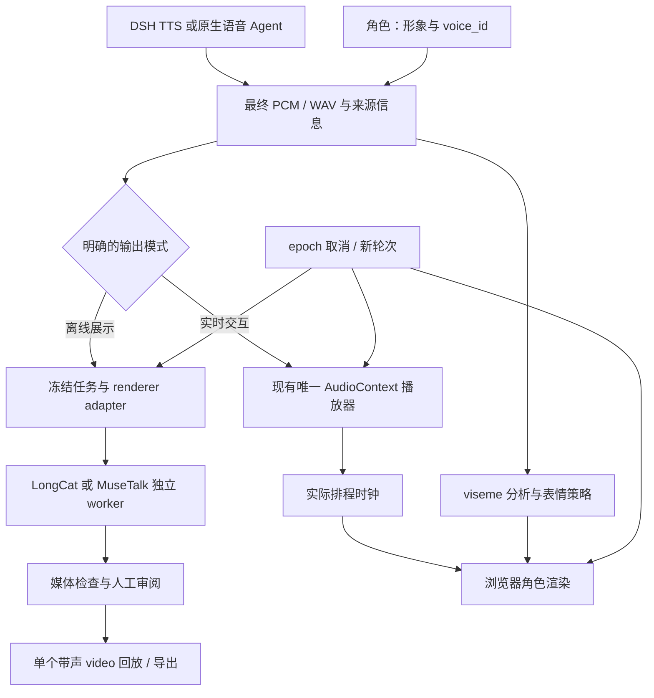

# Avatar 完整表情 选型 扩展路线

核对日期：2026-10-20。依据：官方 README、模型卡、许可证、固定源码及本机现有实现。本文主体保留选型时的来源/接入设计；后续已完成LongCat与MuseTalk的四段E1b对照，OmniAvatar与Hunyuan未运行，实测见文末。[来源与边界](../research_notes/Avatar%20%E5%AE%8C%E6%95%B4%E8%A1%A8%E6%83%85%20%E9%80%89%E5%9E%8B%20%E6%89%A9%E5%B1%95%E8%B7%AF%E7%BA%BF/sources.md)、[版本与哈希](../research_notes/Avatar%20%E5%AE%8C%E6%95%B4%E8%A1%A8%E6%83%85%20%E9%80%89%E5%9E%8B%20%E6%89%A9%E5%B1%95%E8%B7%AF%E7%BA%BF/source-lock.json)、[源码映射](../research_notes/Avatar%20%E5%AE%8C%E6%95%B4%E8%A1%A8%E6%83%85%20%E9%80%89%E5%9E%8B%20%E6%89%A9%E5%B1%95%E8%B7%AF%E7%BA%BF/code-map.md)可复查。

## 1 结论与适用目标

**按“真人形象、完整动态、离线展示、后续可服务化扩展”的目标，建议顺序是 LongCat-Video-Avatar 1.5 → OmniAvatar → HunyuanVideo-Avatar。** LongCat 的优势是可用工程入口更齐全；OmniAvatar 的优势是小模型与 LoRA 结构适合受限预算和研究；Hunyuan 的情绪/动态能力值得保留，但不是本项目扩展成本最低的默认。这个次序是工程判断，不是三者已完成同机画质跑分。

**项目长期结构应保持“语音上游＋可替换的视觉输出层”。** 离线高质量人物视频可以先选 LongCat；需要原生全双工、低等待和可打断时，继续评估浏览器角色驱动。两条路线消费同一份最终音频，但采用不同播放模式。公开视频模型的出片吞吐，不等于实时对话能力。

更准确地说，“完整表情”至少包含：嘴形随音频变化；眨眼/视线/眉毛/头部自然运动；与语义相符的情绪及身体动作。当前 MuseTalk 加静态图只证明了第一类的部分能力。升级生成模型可以增加动作，但不能自动保证笑得合适、闭嘴正确，或修复僵硬的输入音轨。

## 2 三个方案的工程比较

| 维度 | LongCat-Video-Avatar 1.5 | OmniAvatar | HunyuanVideo-Avatar |
| --- | --- | --- | --- |
| 项目定位 | 优先离线真人展示候选 | 轻量/研究备选 | 情绪与动态人物专项备选 |
| 动作与表情 | 图片、音频、文字联合生成完整人物动态；单/多人和续接入口 | 面部、身体动态；提示词情绪和动作控制 | 情绪控制、多人、头像/半身/全身 |
| 推理选择 | 8-step 蒸馏、预制 INT8、480p/720p、视频续接 | 1.3B/14B、LoRA 条件、内存驻留与 TeaCache 配置 | FP8、offload、缓存和多卡路径；低显存版本有性能代价 |
| 接入形态 | 官方 CLI；vLLM-Omni 有模型适配和离线 recipe | YAML＋推理脚本，适合包一层实验 adapter | CLI＋Gradio，多组件路径和配置较多 |
| 许可可扩展性 | 代码/模型卡为 MIT，仍需分别核对依赖/素材 | 代码/14B 模型卡 Apache-2.0，基座等分别核对 | Tencent 社区许可，有地域、分发与用途等附加约束 |
| 未来模型研究 | 有蒸馏推理，不等于已公开本项目可用训练闭环 | 1.3B/14B 与 LoRA 结构使研究切入较方便，完整训练流程仍需补 | 专项控制研究可考虑，跨模型输出复用还受许可约束 |
| 本项目实时接入 | 待另证；公开 recipe 明示离线 | 未证明因果流式与低延迟取消 | 未证明因果流式与低延迟取消 |

能力来源：[LongCat 官方入口](https://github.com/meituan-longcat/LongCat-Video)、[OmniAvatar 项目页](https://omni-avatar.github.io/)、[Hunyuan 官方入口](https://github.com/Tencent-Hunyuan/HunyuanVideo-Avatar)。许可来源：[LongCat 模型卡](https://huggingface.co/meituan-longcat/LongCat-Video-Avatar-1.5)、[OmniAvatar 模型卡](https://huggingface.co/OmniAvatar/OmniAvatar-14B)、[Hunyuan LICENSE](https://github.com/Tencent-Hunyuan/HunyuanVideo-Avatar/blob/8c31d0d489df8418fa36a2a709ebdf0b47c7bf06/LICENSE)。

### 2.1 为什么 LongCat 优先，但不能直接叫“生产成熟”

LongCat 把多个实用推理路径放在同一个公开工程里。v1.5 已提供蒸馏、INT8 和续接，后续需要长说明视频、多人物或批量出片时，可在同一模型族内逐步扩展。[官方版本说明](https://github.com/meituan-longcat/LongCat-Video/blob/6b3f4b8582a8bc3f20f795735f5383716c4ba794/README.md)

vLLM-Omni 已有对应适配。其社区维护的 recipe 列出 1×H100 80GB 条件和验片方法；93 帧、INT8、8-step 示例的全程 GPU 峰值约 41.0 GiB（CPU build）或 56.8 GiB（GPU build），加载约 130 s 或 33 s。这些是对方 Modal H100 条件，不能视作本机耗时或长视频显存预算。recipe 明确写 **offline only、online serving 尚未支持**；也不能把 vLLM 其他模型的并行/加速特性直接套过来。[适配与限制](https://github.com/vllm-project/vllm-omni/blob/main/recipes/meituan-longcat/LongCat-Video-Avatar-1.5.md)

因此第一版先包装官方 CLI 做四段比较；视觉收益成立后，再决定是否接 vLLM-Omni。引入适配框架的理由应是实际调度与运维需求，不是为了让实验多一层技术栈。CLI 和 vLLM 适配要分别记录 backend/版本，不能假设输出完全相同。

### 2.2 OmniAvatar 何时更值得选

若目标转为较小模型、音频条件研究或 LoRA 原型，OmniAvatar 更有吸引力。它公开了 1.3B/14B 路径；官方 14B A800 表列出约 36G 常规驻留、21G 部分驻留和 8G 强 offload 条件，但越省显存越慢。表中时间是 **s/it**，不能直接与当前 MuseTalk 的完整任务 7.165 s 比快慢。1.3B 的本机质量和成本仍需单列测量。[官方配置与内存表](https://github.com/Omni-Avatar/OmniAvatar/blob/1536bf31abaec74364fb7d5883470d5b23ffa7f8/README.md)

LoRA 加载结构方便理解和改造，但本次固定快照未见完整训练启动入口；“架构适合研究”不等于“已有一键微调”。本项目已有 ASR/数据训练主线，Avatar 第一阶段宜先做推理与输出可靠性；视觉训练是后续独立问题。

### 2.3 为什么 Hunyuan 暂排第三

Hunyuan 有情绪与动态人物设计、Gradio 和多种推理方式，不能把它理解为只有嘴型的旧方案。不过官方原生说明的最小 24GB 路径很慢，推荐 96GB；README 提到的 10GB 是 Wan2GP 的另一条实现路径，不是原生配置可无代价替换。官方 ComfyUI 计划在本次快照仍未勾选，第三方集成应另外核验。[原生要求与入口](https://github.com/Tencent-Hunyuan/HunyuanVideo-Avatar/blob/8c31d0d489df8418fa36a2a709ebdf0b47c7bf06/README.md)

其许可与 MIT/Apache 不同：有 EU/UK/韩国的地域排除、分发标识，以及不得用作品/输出改进其他 AI 模型等条款。对未来公开分发、跨地区使用或构造跨模型训练材料，这会增加约束。这里讨论的是该模型及其输出，不是独立上游源音频的权利。[具体条款](https://github.com/Tencent-Hunyuan/HunyuanVideo-Avatar/blob/8c31d0d489df8418fa36a2a709ebdf0b47c7bf06/LICENSE)

### 2.4 对“成熟度”的限度

核对的默认分支提交分别为 LongCat 2026-05-27、OmniAvatar 2025-08-06、Hunyuan 2025-12-16，均未归档。更新日期只描述快照，不提供维护承诺。本次文件树中均未见 `.github/workflows` 或完整训练启动入口；这不代表作者没有内部测试，但说明项目仍需自己的安装、契约、回归与评测。star 数与作者的 production-ready/SOTA 宣传不作为本项目验收。

本机尚无三个候选的同条件数据，所以暂不排名“谁画质一定最好／谁一定最快”。当前能给的结论是：**LongCat 的可选工程路径更适合本次离线扩展，OmniAvatar 的规模选择更适合轻量与研究，Hunyuan 在本项目约束下收益尚不足以优先承担其复杂度。**

## 3 直接接入时最容易踩的坑

### LongCat：长音频不能仍用默认单段

固定源码的 v1.5 使用 93 帧、25 fps，每段 3.72 s，后续段复用 13 帧条件、各增加 3.20 s。5–6 s 的输入至少需要两段，总覆盖 6.92 s。其导出函数会按生成视频长度裁音频：只跑默认一段，可能得到可播放但句尾被截断的文件。[生成逻辑](https://github.com/meituan-longcat/LongCat-Video/blob/6b3f4b8582a8bc3f20f795735f5383716c4ba794/run_demo_avatar_single_audio_to_video.py)、[导出逻辑](https://github.com/meituan-longcat/LongCat-Video/blob/6b3f4b8582a8bc3f20f795735f5383716c4ba794/longcat_video/audio_process/torch_utils.py)

还要记录 raw audio 与 vocal separation 后的 conditioning audio，分别保存哈希、采样率、时长及已知偏移；不能默认分离前后完全等价。原始最终音频仍是展示音轨的来源。干净 TTS 是否跳过分离，要做带版本记录的小兼容修改，不能假装上游已经有任意开关。

蒸馏分支会将 steps 固定为 8、文字与音频 guidance 固定为 1.0。因此照 README 的一般 CFG 建议做网格，可能参数改了却被覆盖。先确认实际生效配置，避免重复无效实验。

### OmniAvatar：音频前缀不是零

默认 `silence_duration_s=0.3`。推理输入前加 0.3 s，导出音轨前加 `0.3 + 1/fps`；25 fps 时为 0.34 s。原始音频与成片音轨需要显式时间映射。这不是“模型同步差 340 ms”的测量结论。[输入/导出代码](https://github.com/Omni-Avatar/OmniAvatar/blob/1536bf31abaec74364fb7d5883470d5b23ffa7f8/scripts/inference.py)、[实际前置静音函数](https://github.com/Omni-Avatar/OmniAvatar/blob/1536bf31abaec74364fb7d5883470d5b23ffa7f8/OmniAvatar/utils/audio_preprocess.py)

如需消除展示前缀，应同步处理视频与音频，并保留变换记录；单独换回无前缀音轨会重新制造错位。当前 ±32 ms 的源音轨搜索范围是 E1 原样复用音频的检查，不能硬套这种带已知前缀的输出。

### 三者共有：文件完成不等于可流式、可取消

默认调用普遍消费完整文件，可能先做全音频特征。分段视频续接只说明可以延长出片，不证明输入未来音频尚未到达时能够低等待跟随。也要区分“停止播放、丢弃旧结果”和“GPU 生成立即停止”；后者必须在所选 worker 中专门验证。

不同模型用不同环境与进程。当前 MuseTalk 的 torch 2.0.1 环境保留，不能与 LongCat/Omni 的不同依赖混装。公开多卡命令也不能原样照抄到共享机器；先单卡资源预检、独立目录，遇到外部工作占用就延期，不驱逐其他任务。

## 4 结合已有仓库，保留哪些代码

**继续使用独立 speech-avatar，DSH 与预约 Agent 通过薄适配器提供最终音频。** 不把这些模型放进当前生产 bridge 的模型管理器，也不复制 ASR、对话、翻译和预约状态。所有视觉后端都服从同一个输入与回放约定。

| 当前代码 | 保留／复用 | 需要的最小演进 |
| --- | --- | --- |
| [E0 校验](https://github.com/HenryVarro666/speech-avatar/blob/main/scripts/validate_e0.py)、[MuseTalk worker](https://github.com/HenryVarro666/speech-avatar/blob/main/workers/musetalk/run_e1.py) | 冻结、哈希、失败记录、资源隔离与明确计时 | 新建 `workers/longcat/`，共用薄任务描述；当前 worker 依赖 MuseTalk 内部埋点，不能只换模型名。 |
| [媒体检查](https://github.com/HenryVarro666/speech-avatar/blob/main/scripts/analyze_e1.py)、[质量检查](https://github.com/HenryVarro666/speech-avatar/blob/main/scripts/audit_e1_quality.py) | 解码、音轨保存、偏移曲线、逐帧证据 | 小范围提取通用函数／参数化新实验路径；移动人物改为逐帧检测/跟踪，保留旧 E1 结果。 |
| [speaker.ts](https://github.com/HenryVarro666/dsh-voice-ai-girlfriend-plugin/blob/master/src/client/voice/speaker.ts) | AudioContext、PCM 排程、FIFO 和 stop/gen | 在真实 `schedule()` 点增加 PCM、排程时刻、采样偏移和 epoch 的只读事件。现有 subscribe 只有 speaking 状态，尚无该能力。 |
| [companion.tsx](https://github.com/HenryVarro666/dsh-voice-ai-girlfriend-plugin/blob/master/src/client/voice/companion.tsx) | 浮窗、idle、队列、打断与历史不重播经验 | 实时模式增加独立渲染器；离线回放明确使用带声视频。speaking 布尔值不能充当口型驱动。 |
| [reply-listener.tsx](https://github.com/HenryVarro666/dsh-voice-ai-girlfriend-plugin/blob/master/src/client/voice/reply-listener.tsx)、[voice_bridge.py](https://github.com/HenryVarro666/dsh-voice-ai-girlfriend/blob/main/bridge/voice_bridge.py) | 既有上游和可用的错误/任务语义 | 旧 dhMode 会转走完整文本、另合成视频音频；新路径接已经完成的音频，避免重复 TTS 与双重播放。 |
| [native server](https://github.com/HenryVarro666/local-speaker-lab/blob/main/src/speaker_lab/scheduling/server.py)、[native page](https://github.com/HenryVarro666/local-speaker-lab/blob/main/src/speaker_lab/scheduling/page.html) | epoch、playback_reset、24 kHz 原生 PCM 与排程 | 添加第二个薄适配器，保留源采样率与时钟；不要求原生输出再经过 TTS。 |
| [DuplexLab 审阅](https://github.com/HenryVarro666/local-speaker-lab/blob/main/src/speaker_lab/duplex/review.py) | reviewer、哈希、真实听检与修改历史的契约思路 | 新增视频审阅字段；它不是现成的视频 MOS 组件，首版不搬整套训练/数据库。 |

本地文件当时哈希在来源锁中；若未来改插件，需要同步主仓库的插件源码镜像并做原有回归。本轮没有修改这些运行代码。

## 5 建议的系统边界

**两种模式各有唯一音频所有者。** 离线 MP4 回放由 `<video>` 负责音画时钟，不再让 ReplySpeaker 同时播一遍；实时模式由 AudioContext 播 PCM，视觉层只渲染。不能先播完整回复，过几秒又自动播放它的成片音轨。

首次实现只需要 `render(job) -> artifact` 的薄 adapter，保留三部分：

- **角色配置**：`avatar_id`、`voice_id`、语言、图像/视频资产哈希、允许的风格提示。男/女声按这两个虚构角色的人设绑定，不从图片临时猜。TTS 由上游导出；Avatar 不负责合成声音。
- **离线任务**：任务/utterance id、epoch、源音频哈希/采样率/时长、后端/源码/模型/配置哈希、seed、输出路径；另记 conditioning audio 与时间变换。seed 固定不承诺跨硬件逐位一致。
- **成品描述**：原生分辨率/fps、音轨与源的映射、完整命令耗时、可观测的加载/生成阶段、GPU 进程峰值口径、技术检查与人工评分状态。没有埋点的首帧为 null。

阶段状态可以沿用简单的 `queued → preparing → rendering → validating → ready`，另有 `failed/discarded`。UI 收到取消后立刻停播并使旧 epoch 失效；即使后台出片晚到也不能恢复播放。底层是否能协作停止是独立能力字段，未实现时如实标记，不把丢弃结果冒称节省了 GPU。

### 实时表情应怎样补齐

现有 ReplySpeaker 适合做实时音频时钟，但还缺观测接口。事件应从音频排程点发出，带 `utterance_id/epoch/chunk_index/sample_rate/sample_offset/context_start_time`；网络到达时刻或文字到达时刻都不能代替它。发生音频欠载而重新排程时，嘴形也跟着实际时轴调整；取消清空 viseme、表情过渡和旧结果。

浏览器候选将嘴部 viseme、眨眼/视线/轻微头动、语义表情分为独立通道。[HeadAudio](https://github.com/met4citizen/HeadAudio)可提供嘴部权重，完整表情仍需要角色 rig 和表情策略。默认模型来自英语合成声音，当前中文要独立验收；用可控中性/温和表情起步，先测同步、附加等待和取消，再考虑更多情绪。

原生预约 Agent 已有 24 kHz PCM＋epoch 入口；它是未来第二个适配对象。口译接入时，Avatar 跟随译音，原文/译文与语言方向由上游负责。目前仓库没有完成专门口译流程，不能只加一个人物就宣称已有口译产品。

## 6 按价值推进的最短路线

| 阶段 | 最小交付 | 进入下一步的条件 |
| --- | --- | --- |
| A：输入与人设 | 男女角色各一段自然中文 5–6 s，先单独听检；语言、音色、原文、哈希与人设匹配 | 用户确认声音自然、内容正确、角色匹配。若声音不合适，停在音频层修改，不浪费渲染。旧 E0/test 不覆盖。 |
| B：四段直接对照 | 两个角色各用自己的同一段音频，MuseTalk 与 LongCat 1.5 各生成一段，共四段；LongCat 预先设两段续接覆盖音频 | 4/4 媒体完整、无截音；按角色做两组盲比，同步、身份和收尾无明显退化，表情有可见价值。分不清或没有收益就不追加参数网格。 |
| C：复用的实验工具 | 小任务描述、LongCat adapter、带哈希的人听审阅页、可保存结果 | 换后端不改音频上游；取消后旧结果不播放；来源/计时/失败清楚。不是先建云队列、数据库或多个发布包。 |
| D：选择一个演示方向 | 离线真人说明/预约回复；或按 E2–E4 做实时浏览器角色 | 离线版以成片价值与成本验收；实时版单独测附加等待、欠载、断流与取消，均不能替代真人语音主链路验收。 |
| E：有限扩展 | 只有四段结果支持时，才补两语言、半身参考、长句与续接；再决定是否批量服务化 | 半身动作要新增版本化参考资产；当前头像裁切不适合评价手势。测试集在调参期间保持封存。 |

四段只是决定是否值得继续的试点，不宣布大样本质量或稳定 p95，也不代替旧 E1 的 ≥10/12 人工签收要求。第一轮不同时装三个大模型；LongCat 若因预算/环境无法运行或画质收益不足，再用同样输入试 OmniAvatar 1.3B。Hunyuan 等到确有特殊情绪/多人需求再引入。

比较时保留原生输出并在相同显示尺寸审阅，报告 MuseTalk 512×512 与 LongCat 的原生尺寸差异。新 CLI 若每个进程都加载模型，其命令耗时包含加载；当前 E1 的 7.165 s 排除共享加载，不能直接把两个数字相减当提速。冷进程、共享加载后的任务、首保存帧、浏览器首画面分别命名；未测的不补数字。

审阅页复用当前画廊的媒体与目录组织，增加 reviewer、设备、原速/慢速、音色自然度、角色匹配、同步接受、牙齿/身份、表情恰当和复查时间点。页面生成和浏览器 `ended=true` 都不是人工通过，SyncNet 也只是辅助。当前静态 E1 使用固定人脸框；新模型头部会动，应按帧跟踪，不能照搬其固定 ROI。

## 7 仓库和本轮交付

speech-avatar 长期承载视觉与同步实验；voice_ai 留语音基线、上游接入和历史协调记录；local-speaker-lab 保留原生预约与数据/训练证据。当前已有大量语音实验，Avatar 下一步以四段可比较样片和可复用输出契约为目标，避免重新造一个语音助手。

本报告与来源记录已保存，speech-avatar 的技术路线和双方状态/历史入口同步。该选型阶段没有开始 A–E、新模型安装或推理，也没有访问 SSH/apex、修改生产代码、暂存、提交或推送。E1 仍为 NEEDS WORK，人工逐段音画签收状态不变。

## 8 后续E1b实测更新（2026-10-20）

用户已接受自然男女中文原音，独立speech-avatar完成MuseTalk/LongCat四段，[完整实测与失败记录](https://github.com/HenryVarro666/speech-avatar/blob/main/experiments/2026-10-20-e1b-full-expression/RESULTS.md)。4/4完整解码、音轨与浏览器播放通过，516帧动态跟踪/嘴部检查。含加载整进程MuseTalk23.916/23.607s、LongCat270.721/267.728s；原生512×512与640×608，不与旧E1排除共享加载7.165s直接比较。LongCat两段续接覆盖原音，没有以3.72s首段冒充完整回复。

当前证据支持“LongCat可增加可见眨眼、眉眼、头肩运动”，同时发现裁切边缘手势，仍有辅助同步偏移提示。人工视频质量/偏好待反馈，不能更新为已签收、实时可用或三后端画质排名。优先看完现有两组A/B，再决定是否有界优化手势/半身参考、派生中性收尾和同步；不追加无效DMD steps/CFG网格，不立刻安装其他大模型。原E1 NEEDS WORK结论不变。

新增独立worker、冻结任务/哈希校验、媒体工具与GPU拒绝保护、逐次失败/资源计时、动态跟踪及A/B揭示页；未修改DSH业务或apex。两次外部GPU队列冲突保留为拒绝，等待后执行，不干预别人的任务。仍需共享机器原子资源租约与后续真正AudioContext/epoch接入；当前预览仅回放MP4。

## 9 E1b完整质量审查后的选择（2026-10-20）

[四段审查](https://github.com/HenryVarro666/speech-avatar/blob/main/experiments/2026-10-20-e1b-full-expression/quality-review-v1/REVIEW.md)维持LongCat为离线完整表情开发主候选，MuseTalk为低成本口型/回归基线，当前两者均NEEDS WORK。原全片估计已复现，男LongCat末窗从40变80ms，只差一帧不作时钟漂移定论；不统一移音。LongCat有眨眼/眉眼/头动但部分时刻用力、齿列白亮块状、手部闯入裁切，需要约束，未确认多指或粗大拼接断裂。

[下一轮](https://github.com/HenryVarro666/speech-avatar/blob/main/experiments/2026-10-20-e1b-full-expression/quality-review-v1/NEXT_EXPERIMENTS.md)先0GPU本地同步比较，再只改正面prompt生成男女各1段，达标后才各加300ms中性尾段。固定源码CFG1/1路径无负面提示编码，不能把增加负面词当生效修复；也不启动无效steps/CFG网格。最多2+2段新成功生成，未在本审查中执行。实时AudioContext/epoch路线和其他后端仍分别验收；本次全为本机审查，无SSH/apex或生产变更。

## 10 E1c受控提示实测（2026-10-22）

[新实测](https://github.com/HenryVarro666/speech-avatar/blob/main/experiments/2026-10-21-e1c-controlled-expression/RESULTS.md)完成6份本地同步副本及2段LongCat受控正面提示新片。后者同音频/底图/seed42/INT8蒸馏配置仅换正面prompt，执行input.json已核对；整进程267.418/263.161s，新258帧嘴部和下沿、衔接/结尾复查。手部仍从下沿进入、张嘴/眉眼幅度及白亮粘连齿列没有明确改善，不能把“可提示控制”直接推成这条部署配置已可控。只否定这两条输入下的提示方案，不泛化所有LongCat路径。

按预设门槛跳过300ms收尾（0次），不再挑seed或堆负面词。同步副本全部源帧/PCM语音保留，可盲比后另选补偿；模型接近零不代替人工接受。LongCat仍为离线研究候选、MuseTalk保留基线，两者未签收为精修成品。下一轮应另冻一种可验证的更强构图/动作条件，或先查非蒸馏文本引导实际路径和成本；不自动安装其他模型或扩大网格。实时AudioContext/epoch继续单独验收。本轮不访问apex、不改上游业务、不提交推送。
